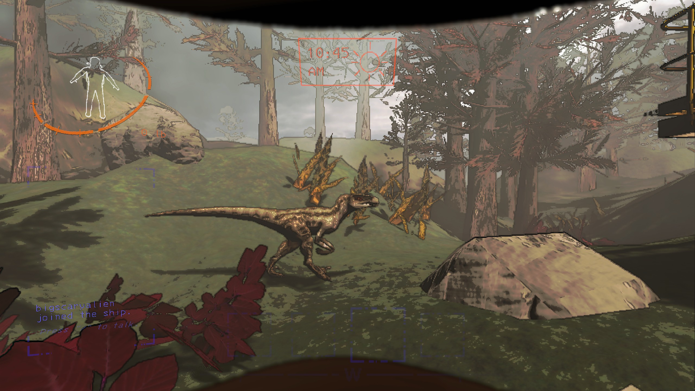

# JPOGRaptor 🦖

This mod adds the Raptor from the game [Jurassic Park Operation Genesis](https://en.wikipedia.org/wiki/Jurassic_Park:_Operation_Genesis).

> ⚠️  
> The Raptor is still WIP.
> It should function well enough to work as an outside enemy in the game, but still needs further tweaking and updates.

## Description 📃
JPOGRaptor is a fully animated custom enemy that can spawn outside during the nighttime.
The Raptor hunts players who are alone. It sneaks up on you and kills with a pounce or its bites. If it misses, it runs back to the pack and calls for backup from other Raptors, so be careful!

## Preview

### Behavior ▶️
- Player spotting:
    - The Raptor goes for players who are alone. Players standing close to other players are ignored.
    - A player who gets too close, or who shoots the Raptor, is attacked right away.
- Stalking:
    - The Raptor sneaks up on its target while staying out of sight, and pounces once close enough.
    - If a player spots it while stalking, it hides and starts searching again.
- Chasing:
    - The Raptor will chase the player.
- Attacking:
    - The Raptor will attempt a pounce attack once close enough.
    - Colliding with the Raptor will damage you.
- Backup:
    - A Raptor that misses its pounce runs back to the pack and calls for help with a long bark.
    - Nearby Raptors answer the call and join the chase.
- Killable:
    - The Raptor should take 2 shotgun hits to kill.
    - The Raptor should take around 5-6 shovel hits to kill.
    - The Raptor does damage to other monsters when colliding with them.

## Feedback 📢
Feel free to leave feedback and/or report bugs you encounter on the Discord thread for JPOG T-Rex or by creating a GitHub issue!  
- [Lethal Company Modding discord](https://discord.com/channels/1168655651455639582/1267152262602555473):  
    [Modding] > [mod-releases] > [JPOG | T-Rex 🦖 | Stegosaurus | Raptor] 
- [GitHub Issues](https://github.com/347956/JPOGRaptor/issues)

### Other projects 💭
- Add other JPOG dinosaurs.
    - [Stegosaurus](https://thunderstore.io/c/lethal-company/p/347956/JPOGStegosaurus/) ✅
    - [T-Rex](https://thunderstore.io/c/lethal-company/p/347956/JPOGTrex/) ✅

### TODO 🛠️
- Tweaks and fixes to behavior.
- Make the Raptor drop items on death.
- Make the Raptor able to follow the player inside.
- Maybe give the Raptor a nest, similar to the bird/kiwi enemy.

## Source 🌐
The source code for the Raptor can be found on my [GitHub](https://github.com/347956/JPOGRaptor).

## JPOGRaptor assets 📦
All assets (model, textures, animations, and some audio) are from the game:
[Jurassic Park Operation Genesis](https://en.wikipedia.org/wiki/Jurassic_Park:_Operation_Genesis)

## Credits 🗣️
- [EvaisaDev](https://github.com/EvaisaDev) - [LethalLib](https://github.com/EvaisaDev/LethalLib)  
- [Lordfirespeed](https://github.com/Lordfirespeed) - reference tcli usage in LethalLib  
- [Xilophor](https://github.com/Xilophor) - csproj files taken from Xilo's [mod templates](https://github.com/Xilophor/Lethal-Company-Mod-Templates)  
- [XuuXiao](https://github.com/XuuXiao/) - porting LC-ExampleEnemy for LC v50  
- [nomnomab](https://github.com/nomnomab) - [Lethal Company Project Patcher](https://github.com/nomnomab/lc-project-patcher) - used for the Unity Project
- [HENDRIX-ZT2 ](https://github.com/HENDRIX-ZT2) & [AdventureT](https://github.com/AdventureT) - creating the Blender plugin: [jpog-blender](https://github.com/HENDRIX-ZT2/jpog-blender) that is able to read ".tmd" files from the game: [Jurassic Park Operation Genesis](https://en.wikipedia.org/wiki/Jurassic_Park:_Operation_Genesis)

## AI Usage
I used AI to assist me during development and help find/fix bugs and issues.