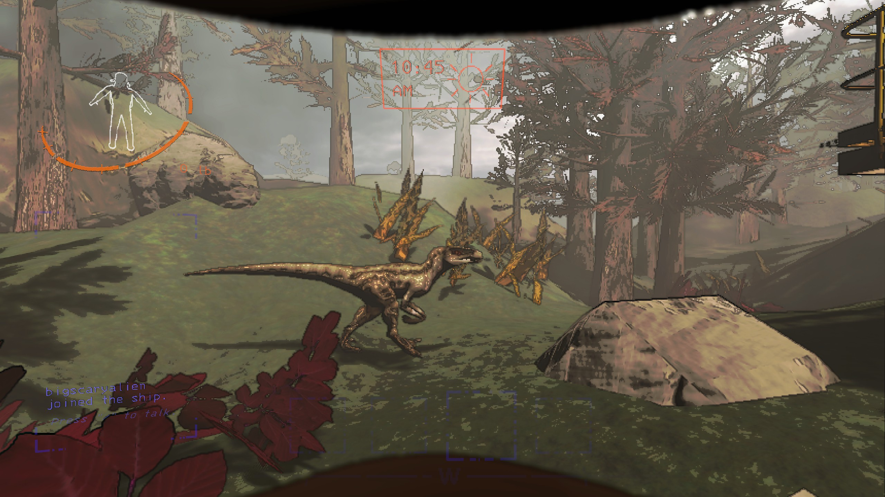

# JPOGRaptor 🦖

This mod adds the Raptor from the game [Jurassic Park Operation Genesis](https://en.wikipedia.org/wiki/Jurassic_Park:_Operation_Genesis).

> ⚠️  
> The Raptor is still WIP.
> It should function well enough to work as an outside enemy in the game, but still needs further tweaking and updates.

## Description 📃
JPOGRaptor is a fully animated custom enemy that can spawn outside during the nighttime.
The Raptor will chase you and try to kill you with a pounce or its bites. It is able to call for backup from other Raptors, so be careful!

## Preview



### Behavior ▶️
- Player spotting:
    - The Raptor still uses the default spotting of players in front of it within X range.
    - I plan to tweak this further.
- Chasing:
    - The Raptor is able to call for backup from other Raptors when it spots a player.
    - The Raptor will chase the player.
- Attacking:
    - The Raptor will attempt a pounce attack once close enough.
    - Colliding with the Raptor will damage you.
- Killable:
    - The Raptor should take 2 shotgun hits to kill.
    - The Raptor should take around 5-6 shovel hits to kill.
    - The Raptor does damage to other monsters when colliding with them.

## Feedback 📢
Feel free to leave feedback and/or report bugs you encounter on the Discord thread for JPOG T-Rex or by creating a GitHub issue!  
- [Lethal Company Modding discord](https://discord.com/channels/1168655651455639582/1267152262602555473):  
    [Modding] > [mod-releases] > [JPOG | T-Rex 🦖 | Stegosaurus | Raptor] 
- [GitHub Issues](https://github.com/347956/JPOGRaptor/issues)

### Other projects 💭
- Add other JPOG dinosaurs.
    - [Stegosaurus](https://thunderstore.io/c/lethal-company/p/347956/JPOGStegosaurus/) ✅
    - [T-Rex](https://thunderstore.io/c/lethal-company/p/347956/JPOGTrex/) ✅

### TODO 🛠️
- Tweaks and fixes to behavior.
- Make the Raptor drop items on death.
- Make the Raptor's vision/detection of players more unique.
- Make the Raptor able to follow the player inside.
- Maybe give the Raptor a nest, similar to the bird/kiwi enemy.

## Source 🌐
The source code for the Raptor can be found on my [GitHub](https://github.com/347956/JPOGRaptor).

## JPOGRaptor assets 📦
All assets (model, textures, animations, and some audio) are from the game:
[Jurassic Park Operation Genesis](https://en.wikipedia.org/wiki/Jurassic_Park:_Operation_Genesis)

## Repository layout 📁

This repository is a folder that goes inside the `Assets/` folder of a Lethal Company Unity project, for example `Assets/LethalCompany/Mods/plugins/JPOGRaptor/`. It holds all of the mod's own Unity content and its code. The host Unity project supplies the generic parts: the game scripts (Assembly-CSharp), the Unity packages and DawnLib (`com.github.teamxiaolan.dawnlib.dusk.dll`).

| Path | Contents |
| --- | --- |
| `Content/JPOGRaptor/` | The enemy: prefab, model, animations, materials, audio, bestiary entries and Dusk registry assets. |
| `JPOGRaptorContentContainer.asset`, `JPOGRaptorModInformation.asset` | The Dusk content container and mod information for the Dusk export. |
| `Package/` | README, changelog and icon of the Thunderstore package (referenced by the mod information). |
| `AssetBundles/` | Build output: the plugin DLL and the exported bundles. Only the `.meta` files are committed; the prefab references the DLL by the GUID in its `.meta`. |
| `Plugin~/` | The C# plugin. The `~` is on purpose: Unity ignores folders ending in `~`, so it doesn't try to compile the BepInEx code. |
| `Tests~/` | xUnit tests for the plain C# rules in `Plugin~/src`. |
| `Screenshots~/` | Screenshots for this README. |

> [!NOTE]
> The Raptor's `Content/JPOGRaptor/Animations`, `Audio` and `Models` folders are gitignored (ripped game assets). Copy them in from your local Unity project before working on the prefab.

## Building 🔨

1. Create `Plugin~/JPOGRaptor.csproj.user` (gitignored, machine specific) with your game path and a target that copies the DLL to `AssetBundles/`:

   ```xml
   <Project>
     <PropertyGroup>
       <GameDirectory>/path/to/Lethal Company/</GameDirectory>
       <ManagedDirectory>$(GameDirectory)Lethal Company_Data/Managed/</ManagedDirectory>
     </PropertyGroup>
     <Target Name="CopyToUnity" AfterTargets="NetcodePatch">
       <Copy SourceFiles="$(TargetPath)" DestinationFolder="$(MSBuildThisFileDirectory)../AssetBundles/" />
     </Target>
   </Project>
   ```

2. In `Plugin~`, run `dotnet tool restore` once, then `dotnet build`. The netcode-patched DLL is copied to `AssetBundles/`, where Unity finds the AI script for the prefab.

> [!IMPORTANT]
> Build the DLL before opening the Unity project after a fresh clone. If the DLL is missing, Unity deletes its `.meta` file and the prefab loses its AI script.

## Credits 🗣️
- [EvaisaDev](https://github.com/EvaisaDev) - [LethalLib](https://github.com/EvaisaDev/LethalLib)  
- [Lordfirespeed](https://github.com/Lordfirespeed) - reference tcli usage in LethalLib  
- [Xilophor](https://github.com/Xilophor) - csproj files taken from Xilo's [mod templates](https://github.com/Xilophor/Lethal-Company-Mod-Templates)  
- [XuuXiao](https://github.com/XuuXiao/) - porting LC-ExampleEnemy for LC v50  
- [nomnomab](https://github.com/nomnomab) - [Lethal Company Project Patcher](https://github.com/nomnomab/lc-project-patcher) - used for the Unity Project
- [HENDRIX-ZT2 ](https://github.com/HENDRIX-ZT2) & [AdventureT](https://github.com/AdventureT) - creating the Blender plugin: [jpog-blender](https://github.com/HENDRIX-ZT2/jpog-blender) that is able to read ".tmd" files from the game: [Jurassic Park Operation Genesis](https://en.wikipedia.org/wiki/Jurassic_Park:_Operation_Genesis)
